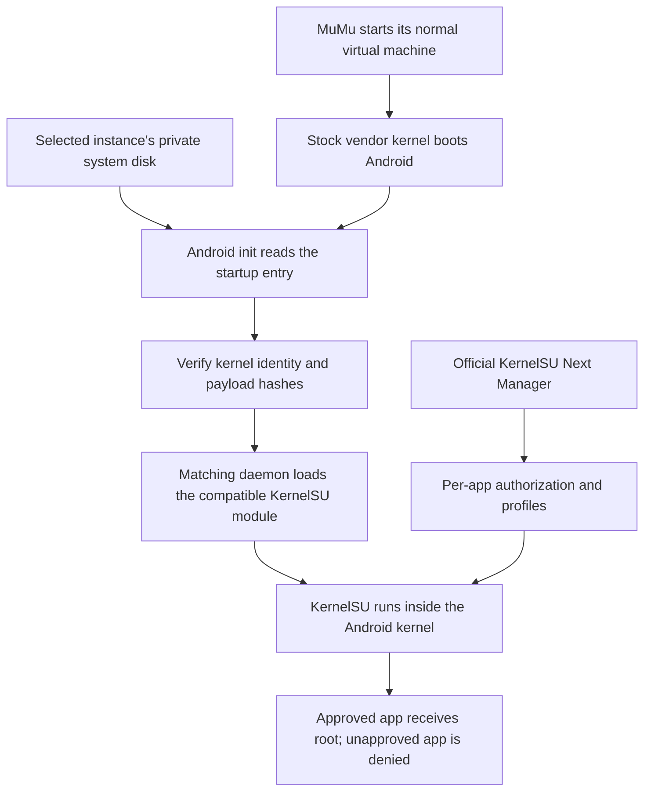

# How this installation works

KernelSU Next is running **inside MuMu's Android kernel**. The private system disk supplies the files and the startup instructions; it is not a substitute for the kernel component.

Think of an ordinary Linux driver loaded after boot. The driver file starts on disk, but loading it makes its code run inside the kernel. A compatible KernelSU loadable module works on the same principle. Its job is to give approved Android processes root privileges and enforce KernelSU's authorization decisions.

## The pieces

| Piece | Role in this installation |
| --- | --- |
| MuMu application on macOS | Runs the virtual machine and provides its vendor kernel and hardware implementation |
| MuMu's stock Android kernel | Continues to run Android and MuMu's graphics, input and other drivers |
| `kernelsu.ko` | The MuMu-specific KernelSU Next kernel component, compiled with the measured vendor compatibility fixes |
| Official Next Manager APK | The Android app in which you approve root access and manage profiles/modules |
| Matching `ksud` daemon | Connects userspace management and module stages to the kernel component; its loader resolves the required kernel symbols |
| Private `system.qcow2` | The selected emulator instance's own virtual Android system disk, containing the module, daemon and startup files |
| Init configuration and boot script | Verify the target and payload, then load KernelSU automatically at the appropriate boot stage |
| Host Python CLI | Builds, checks, installs, clones, captures evidence and performs recovery from macOS |

"Private system disk" means **per-instance storage**, created through MuMu's writable-system support. It does not mean a secret disk format or access to other users' machines. `qcow2` is the virtual disk container; Android sees its normal filesystems inside it.

## Why this is genuine kernel root

The meaningful evidence is the behavior of the running system, not the presence of an APK or a "Working" badge. The kernel answers the native KernelSU control protocol; an authorized process becomes UID 0 in KernelSU's SELinux domain; a fresh unauthorized identity is denied. Those checks continue to work after MuMu's original root option is disabled and the emulator has been fully stopped and restarted.

This gives root **in the Android guest**. It does not root macOS or grant a guest application unrestricted access to the host.

LKM loading is a legitimate Linux kernel extension mechanism and part of the wider KernelSU ecosystem. This particular port is independently maintained; it is not an official MuMu-supported integration or a claim that an arbitrary official GKI binary works on MuMu.

## Why retain MuMu's kernel?

MuMu already has a working kernel and vendor driver combination for its graphics, shared memory, input, sensors and virtual hardware. Replacing the entire kernel would mean reproducing those interfaces as well as adding root. The installed build supports loadable modules, so we can add the root component while retaining the working virtual hardware implementation.

This still required real engineering. MuMu's internal task structure differs from the available Android common source. We measured and corrected that layout difference, adapted the syscall and security hooks, and removed a call into kernel initialization code that had already been freed. These are the reasons a generic downloaded module is not interchangeable with the one built here.

The result is a smaller compatibility problem: maintain a measured extension and its startup path instead of replacing the whole virtual-machine kernel. It is the strongest demonstrated route for the tested build. A future MuMu release can change the constraints; the profile checks identify that case before the installer loads an incompatible module.

## Why Next rather than original KernelSU?

Original KernelSU v0.9.5 provided the initial proof that the mechanism worked on this non-GKI vendor kernel. The completed base port then moved to **KernelSU Next's legacy kernel branch with the official v3.4.2 Manager and daemon**. That combination retained a relevant older-kernel integration path while giving us newer userspace management, and it passed the actual MuMu tests.

"Legacy" here describes the kernel integration branch. It does not mean we renamed an old Manager APK. It also does not mean every feature of Next's latest modern-GKI branch exists on this older kernel. The profile records the exact source commits, version and control-API contract, and the validation record states what was exercised.

The [fork comparison](../research/ROOT-FRAMEWORKS.md) explains the alternatives. More built-in features are useful only if their kernel hooks, daemon, Manager and optional extensions work together on the target.

## What changes during installation and recovery?

The installer stops the selected instance to obtain a consistent backup, enables MuMu's bootstrap root and writable private system disk, copies the checked payload, installs the matching Manager and publishes the startup entry. It verifies a cold boot, switches vendor root off, then verifies another cold boot.

The ordinary installation recovery restores that instance's system disk and settings and removes the Manager it installed. It deliberately retains module data and logs. For updates, the newer `upgrade-clone` path works on a complete separate instance so the original also preserves its Android userdata and Manager state.

The KernelSU module is pinned in memory because its legacy security hooks cannot safely be removed by a casual unload command. Recovery is **restore the disk/startup state and cold boot**. Rebooting discards the running kernel and its loaded extensions.

## Where SUSFS fits

SUSFS adds selected kernel-level controls over what processes can observe. It is a separate capability from obtaining root. The familiar SUSFS module ZIP normally supplies configuration and userspace tools; it needs an actual compatible kernel engine underneath.

The installed complete configuration uses the second of two meaningful engine routes: integrate the canonical patches into a complete compatible MuMu kernel, or port a separate SUSFS LKM to the existing vendor kernel. The latter follows the same general extension strategy as the root component, but touches different filesystem and namespace interfaces and needs independent tests.

A loaded engine, a version response, path hiding, mount hiding and reliable operation under concurrency are separate milestones. The [validation record](VALIDATION.md) records the completed behavior tests, and [SELinux/SUSFS details](SELINUX-SUSFS.md) document the remaining boundaries. Neither a fork name nor a successful status screen proves universal invisibility, and hiding root does not provide hardware-backed device certification.

## Enforcing versus permissive SELinux

Android's regular user IDs separate apps. SELinux adds another access-control layer based on what kind of process is acting and what kind of object it is accessing. Even a root process can be constrained by it.

In **permissive** mode, SELinux records policy violations but allows the operation to proceed. In **enforcing** mode, it denies the operation. Properly integrated root apps can work with enforcement: KernelSU provides the privileged domain and policy mechanisms they need. An app with a genuinely missing permission should receive a narrow, reviewed rule or an app fix instead of requiring the entire emulator to stop enforcing.

The tested MuMu vendor environment started permissive. Its system labels and service identities were not ready for a simple global mode switch. The enhancement therefore repairs those labels and identities, grant the virtual hardware's required permissions, and test both allowed behavior and an operation that must remain forbidden. Root's own privileged domain is a separate policy decision; global enforcing does not mean every individual domain lacks exceptions.

Displaying "Enforcing" while still allowing forbidden app operations would not be the same repair. The test uses an ordinary app and a world-readable file whose SELinux label should prohibit access, alongside rendering, sensor and normal app-storage checks.

## How updates stay manageable

Each profile is a written compatibility contract. It pins the target kernel, vendor reference module, source revisions, Manager/daemon and patches. The tooling captures a new MuMu installation, compares it with the known target, prepares explicit candidates, checks patch application, and tests updates in clones.

An app update with unchanged kernel fingerprints can reuse the reviewed build recipe as a candidate. A new framework revision needs protocol and patch review. A changed kernel needs new layout and hook measurements. The [step-by-step update guide](UPDATING.md) documents each path and exactly what to test before calling the result verified.
