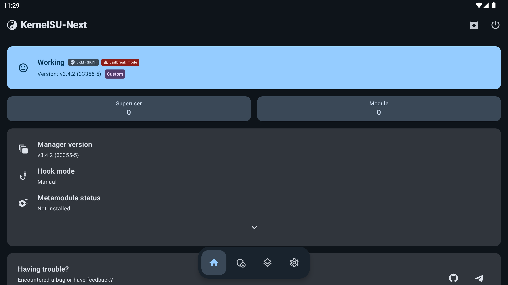

# Validation record — 2026-10-15

Target: MuMuPlayer Pro 1.9.2, Apple Silicon, Android 12, kernel `4.19.195-android-arm64-gedae1315d023`. See the profile for exact image and configuration hashes.

## Completed runtime checks

| Check | Result |
| --- | --- |
| Legacy upstream KernelSU proof | v0.9.5 kernel API returned 11872; manager showed Working; authorized shell obtained UID 0 |
| Current implementation | Custom Next legacy module + official v3.4.2 Manager/daemon |
| Kernel control protocol | `version=33355`, `uapi=5`, flags identify LKM + late-load |
| Manager UI | Working, LKM (GKI1), v3.4.2; custom/jailbreak labels accurately reflect the load method |
| Standard shell root | `su -c id` returns UID 0, `u:r:ksu:s0` after authorization |
| `execveat` | Explicit native `execveat(AT_FDCWD, ...)` root test passes |
| Native test process | UID 2000 before su, UID 0 afterward |
| Vendor root disabled | ADB is UID 2000; authorized KernelSU root still works |
| Unauthorized shell | A fresh installation denies su before the Shell profile is authorized |
| Cold boot persistence | Init hook loads the module and reports ready across full stop/start cycles |
| KernelSU module scripts | Smoke module ran post-fs-data, service, and boot-completed once for the same boot ID |
| Clean build | Pinned sources + included patches built in a fresh Docker toolchain container |
| GitHub cross-build | Linux x86_64 runner produced a byte-identical ARM64 kernel module; its native control probe was also executed successfully in MuMu |
| Automated installer | Completed on a separate fresh instance, including two cold boots and vendor-root shutdown |
| State-change handling | Installation aborted on a changed device state and automatically restored its system/settings |
| Explicit recovery | Restored a pre-existing private system disk; a baseline marker survived; KernelSU and its manager were removed; original root/writability settings were restored |

The native control probe returned:

```json
{"version":33355,"flags":5,"uapi":5,"uid":2000}
```

The authorized root check returned:

```text
uid=0(root) gid=0(root) groups=0(root) context=u:r:ksu:s0
Kernel Version: 33355
```



The smoke module contained no system replacements and required no metamodule. Filesystem-mounting modules and every third-party module have **not** been validated. A metamodule may be needed for their mounting behavior, as shown by Manager's status.

## Host checks

The unit suite exercises ELF metadata parsing, malformed and truncated ELF rejection, archive path traversal rejection, exact guest identity checks, explicit instance selection, bundle integrity gates, and recovery identity/backup checks. Shell scripts pass syntax checks and Python modules compile.

GitHub CI runs host checks on Linux, macOS, and Windows. Those jobs do not imply Windows MuMu support. The manual build workflow cross-compiles the ARM64 module on Linux. Guest runtime testing requires the actual verified MuMu image.

The validated release module SHA-256 is:

```text
b97e681d79d41cbf0c69bf8a494f4e0dc647f6241005f99ccc3ab8a0fe60dc76
```

## Limits of this validation

This establishes functionality on the fingerprinted MuMu build, not ABI compatibility with every 4.19 kernel or long-term stability of arbitrary root modules. The kernel module uses a measured vendor ABI adaptation. Preserve recovery receipts and add new profiles only after repeating the porting workflow.


## Complete enforcing + SUSFS release qualification

The enhanced configuration was installed by `enhance-clone` from the preserved working base, including fingerprinted system-file changes, compiled-policy verification, offline inode labels and normal KernelSU module installation. The final recipe was also exercised through a framework-only clone upgrade.

| Check | Observed result |
| --- | --- |
| Actual kernel enforcement | `/sys/fs/selinux/enforce = 1`; status/AVC masking disabled; no fallback |
| Init and executable labels | Init domain and every critical executable/driver label verified |
| Driver policy | Independent binary-policy inspection confirms ioctl range `0x4c15–0x4c1a` |
| Ordinary Android APK | UI ticks, touch events, accelerometer events, DNS, HTTPS 200 and muted AudioTrack frames advance |
| Enforcement canary | World-readable `system_data_file` denied with EACCES to the app |
| Ordinary app root | Denied before grant; official Next Manager grant enables UID 0 in `ksu`; revocation denies it again |
| Approved app isolation | Its ordinary process still fails the canary read while its root child succeeds |
| Graphics service | SurfaceFlinger functional; `opengl-gc` runs and can restart under enforcement |
| Native path checks | stat/open/O_PATH/listing controlled; root retains access; 0644/0600 modes unchanged |
| Concurrent path test | 72,000 operations, eight workers; 10,000 directory reads with concurrent output-buffer observation; zero observed registered-name leaks or missed probes |
| Mount test | Bind mount hidden from unprivileged mountinfo, fdinfo mapped to visible parent; root retains mount; 30 new namespaces pass |
| Kstat / redirect | Selected metadata changes and replacement reads behave as documented; root view unchanged |
| Mapped-file controls | maps/smaps entries hidden, pagemap entry zeroed, proc-mem read blocked; root access retained |
| SUSFS disable/re-enable | Official daemon module controls plus cold boots remove and restore the engine; root and enforcement remain functional |
| Repeated full boots | Three successive stop/start cycles pass app, root, SUSFS, label and enforcement checks, with vendor root disabled |
| Maintenance preparation | Explicit pinned Next candidate, copied optional recipes, stable content-based policy identity and zero-fuzz patch preflight exercised |

The SUSFS kernel module SHA-256 is:

```text
e21cbf3fd31e89a422025ac8be884ca5623b74b68ebc9925665e212671053736
```

The original core kernel-module hash above remains unchanged. The startup scripts and bundle/source manifests changed. See the release checksums for complete artifact identity and [machine-readable observations](validation-v1.0.0.json).

The observed zero leak/miss counts apply to the stated test workload. Hard-link/symlink directory entries, redirect inode metadata, optional APIs and emulator attestation have explicit boundaries in [SELinux/SUSFS details](SELINUX-SUSFS.md). The test does not certify every game, banking app, anti-cheat, Zygisk implementation or third-party module.
